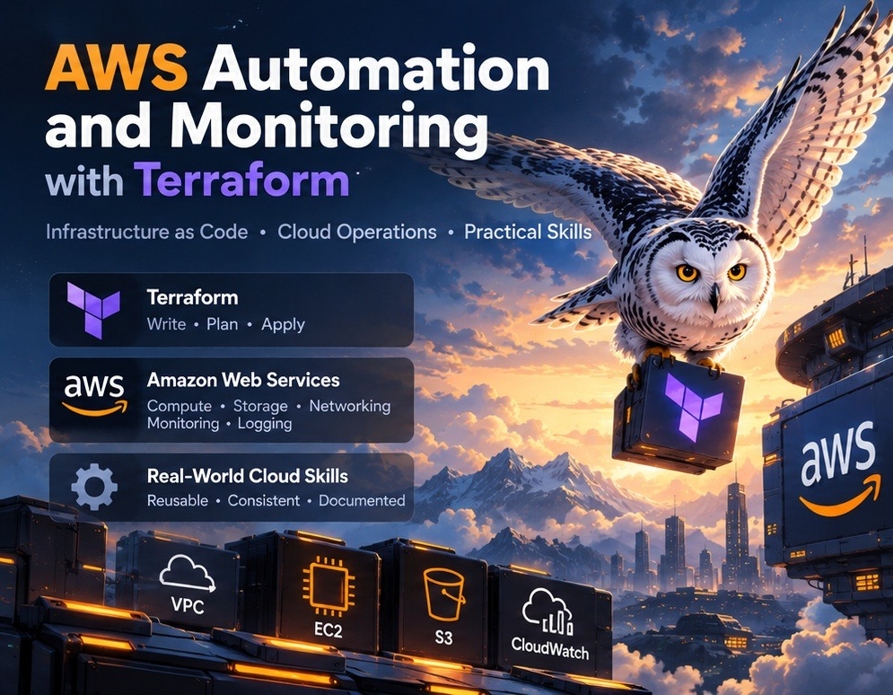
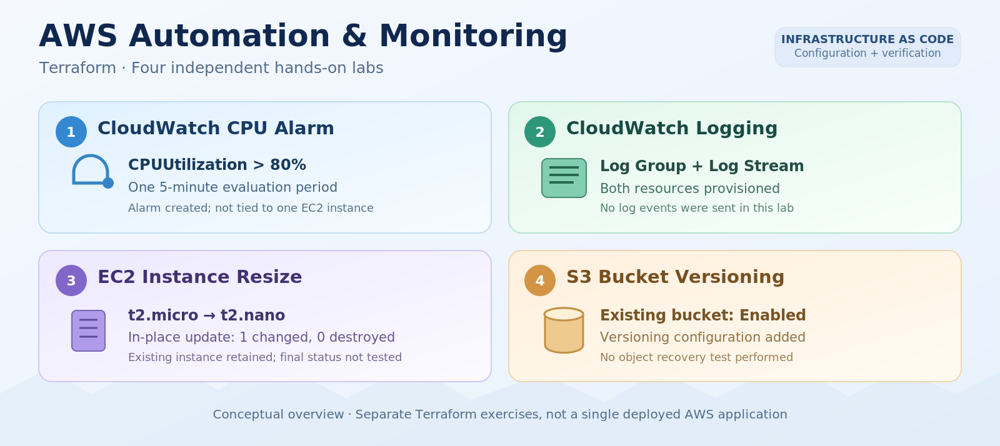
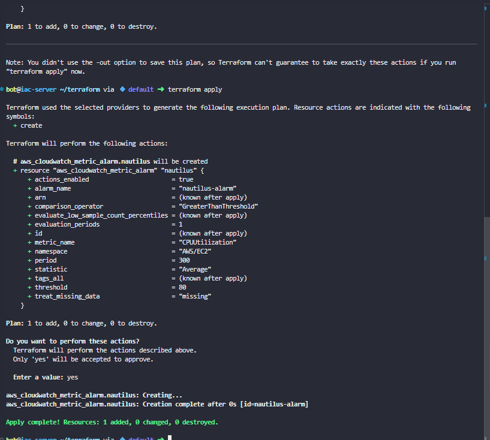
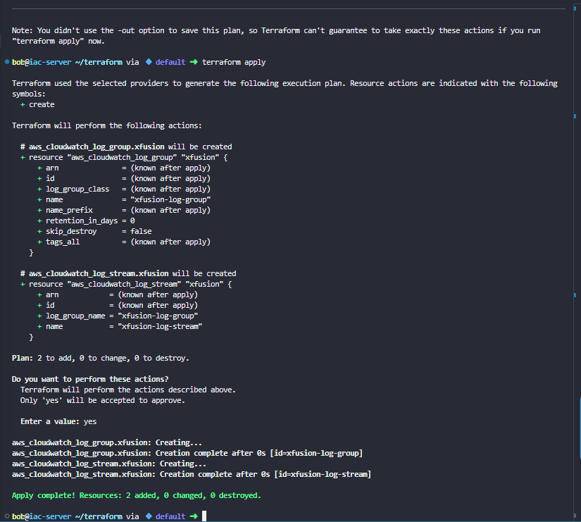
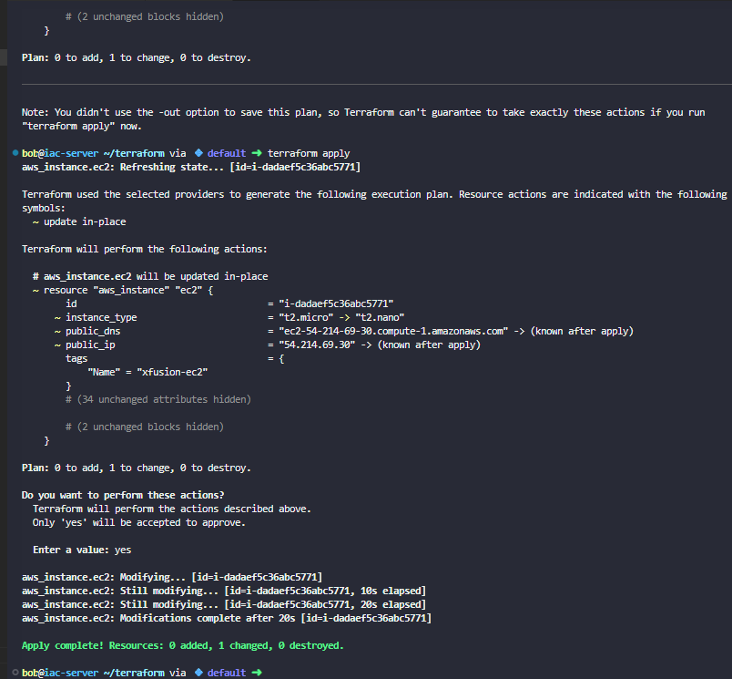
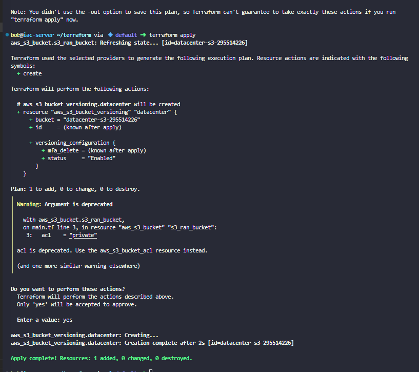

# AWS Automation and Monitoring with Terraform

**CloudWatch monitoring and logging · EC2 resource management · S3 versioning**  
KodeKloud — Nautilus DevOps hands-on Terraform labs



## Project Overview

I completed **four independent Terraform labs** focused on tasks that come after initial cloud infrastructure deployment: defining a CPU alarm, preparing centralized logging, changing an existing EC2 instance's size, and enabling versioning on an existing S3 bucket.

The common theme was managing AWS operations through Infrastructure as Code (IaC). Instead of making each change manually in the console, I defined or updated Terraform resources, reviewed the proposed actions, applied them, and checked the reported outcomes.

**These are separate KodeKloud exercises, not one connected AWS environment or a production monitoring system.** The examples below reflect the configurations and results recorded in my labs.

**Technologies:** Terraform · AWS provider · Amazon CloudWatch · Amazon EC2 · Amazon S3 · Linux CLI · HCL · Terraform state

## The Four Labs

| Lab | Area | What I configured | Verified Terraform result |
|---|---|---|---|
| 11 | CloudWatch alarm | `CPUUtilization` threshold above 80% | 1 resource added |
| 21 | CloudWatch Logs | Log group and dependent log stream | 2 resources added |
| 25 | EC2 management | Change `t2.micro` to `t2.nano` | 1 resource changed in place |
| 28 | S3 protection | Enable versioning on an existing bucket | 1 resource added |



*The overview separates the labs. Actual Terraform execution output is shown in the screenshots under each section.*

## 1. CloudWatch CPU Alarm — Lab 11

**Scenario:** The Nautilus DevOps team wanted to define a repeatable CPU monitoring rule for its AWS environment. The exercise used a CloudWatch metric alarm rather than configuring a threshold manually through the console.

In `main.tf`, I created an `aws_cloudwatch_metric_alarm` resource:

```hcl
resource "aws_cloudwatch_metric_alarm" "nautilus" {
  alarm_name          = "nautilus-alarm"
  comparison_operator = "GreaterThanThreshold"
  evaluation_periods  = 1
  metric_name         = "CPUUtilization"
  namespace           = "AWS/EC2"
  period              = 300
  statistic           = "Average"
  threshold           = 80
}
```

The configuration uses the **average CPU utilization over a five-minute period** and evaluates one such period against the threshold of 80. The `AWS/EC2` namespace identifies the metric family, while `GreaterThanThreshold` specifies the comparison.

**Result:** `terraform apply` reported **1 added, 0 changed, 0 destroyed**, creating `nautilus-alarm`.



**Important limit:** The configuration did not include an EC2 `InstanceId` dimension or an alarm action. The screenshot proves the alarm resource was created, **not** that a specific server was monitored, a threshold was breached, or a notification was delivered. A practical next step would be to bind the alarm to an intended instance and test its behavior.

## 2. CloudWatch Log Group and Stream — Lab 21

**Scenario:** Centralized logs can make application troubleshooting easier, but applications first need a destination for their log events. This lab created the basic CloudWatch Logs structure.

I configured a log group and a log stream in `main.tf`:

```hcl
resource "aws_cloudwatch_log_group" "xfusion" {
  name = "xfusion-log-group"
}

resource "aws_cloudwatch_log_stream" "xfusion" {
  name           = "xfusion-log-stream"
  log_group_name = aws_cloudwatch_log_group.xfusion.name
}
```

The meaningful part is the reference `aws_cloudwatch_log_group.xfusion.name`. Instead of typing the same group name twice, the stream uses the value from the group resource. Terraform can recognize this dependency and create the log group before its stream.

**Result:** The apply output showed the log group being created first, followed by the stream: **2 added, 0 changed, 0 destroyed**.



**Important limit:** No application or CloudWatch Agent was configured to send log events. This verified **logging infrastructure provisioning**, not operational log collection, search, or alerting. The exercise helped me understand how Terraform connects related resources without manually coordinating their creation order.

## 3. Resize an Existing EC2 Instance — Lab 25

**Scenario:** The team wanted to reduce the compute capacity of an underutilized instance, `xfusion-ec2`, without replacing the server. This was a change-management exercise, different from the earlier labs that created new resources.

The existing EC2 resource was already represented in Terraform state. In `main.tf`, I changed the instance type while leaving its other settings unchanged:

```hcl
# Existing aws_instance.ec2 configuration
# Before
instance_type = "t2.micro"

# After
instance_type = "t2.nano"
```

Terraform state associated `aws_instance.ec2` with the existing AWS instance ID. That association mattered: changing the configuration alone would not be enough to identify the right existing resource without the state mapping.

During `terraform plan`, the instance was marked for an **in-place update**, not replacement. The apply operation refreshed the managed resource, modified the instance, and finished with **0 added, 1 changed, 0 destroyed**.



**Why it matters:** Terraform can manage changes to existing infrastructure, not only initial provisioning. The plan helped me distinguish an update from a destroy-and-recreate operation before approving it.

**Verification limit:** The screenshot confirms Terraform's successful in-place change from `t2.micro` to `t2.nano`. It does not independently verify the instance's final **running** status, uptime, or actual cost savings. EC2 resizing can also involve a stop/start interruption, so production changes require scheduling and workload checks.

## 4. Enable S3 Bucket Versioning — Lab 28

**Scenario:** The team needed a way to retain previous versions of objects in an existing S3 bucket, reducing the risk associated with accidental overwrites or deletions.

The bucket `datacenter-s3-295514226` was already managed by Terraform. I added a separate versioning resource and linked it to the existing bucket's ID:

```hcl
resource "aws_s3_bucket_versioning" "datacenter" {
  bucket = aws_s3_bucket.s3_ran_bucket.id

  versioning_configuration {
    status = "Enabled"
  }
}
```

Here, `aws_s3_bucket.s3_ran_bucket.id` points to the existing bucket resource. The new configuration controls versioning **without creating a new bucket**.

**Result:** Terraform reported **1 added, 0 changed, 0 destroyed** for the versioning resource. The screenshot shows its creation completed successfully.



The apply output also included a **deprecation warning** for `acl = "private"` in the existing bucket configuration. This warning did not block the versioning change. For maintainable configurations, ACLs should be managed using the current provider-supported approach rather than leaving deprecated arguments in place.

**Verification limit:** No sample objects were uploaded, overwritten, deleted, or restored to test version recovery. The result demonstrates versioning configuration, not a completed recovery exercise. S3 versioning is useful protection, but it is not a replacement for a full backup and retention strategy.

---

## Terraform Workflow and Verification

For each exercise, I followed the same basic sequence:

```bash
terraform init
terraform plan
terraform apply
```

- **`init`** prepared the working directory and providers.
- **`plan`** showed the intended create or update operations before changing infrastructure.
- **`apply`** executed the reviewed configuration and reported the result.

The main verification method was the **Terraform execution output**, not separate live AWS Console screenshots. I treat an `Apply complete` message as evidence that Terraform completed the requested operation, while keeping it distinct from testing the actual application, alarm, logs, or recovery behavior afterward.

| Lab | What was confirmed | What was not tested |
|---|---|---|
| CPU alarm | Alarm resource created | Instance-specific alarm state or notifications |
| CloudWatch Logs | Group and stream created | Log events sent or searched |
| EC2 resize | Existing instance updated in place | Final running state or measured savings |
| S3 versioning | Versioning resource enabled | Object version restoration |

## Troubleshooting and Practical Lessons

These labs had fewer runtime failures than some of my earlier projects, but they introduced several important administrative distinctions.

**Resource references and dependencies.** In the logging and S3 labs, referring to an existing Terraform resource made the relationship explicit. I learned why this is safer and easier to maintain than repeatedly hardcoding names or IDs.

**Create versus update.** In Lab 25, the plan showed one existing EC2 resource changing in place. Reading the plan before applying matters because unexpectedly replacing a resource could disrupt a workload.

**Warnings are different from failures.** Lab 28 completed even though the AWS provider warned about the deprecated S3 bucket ACL argument. The deployment worked, but the warning identified configuration that should eventually be updated.

**Infrastructure setup is not the same as end-to-end validation.** A created CPU alarm is not proof it fired. A log stream is not proof events reached it. Similarly, enabling bucket versioning is not proof that restoring a previous object version was tested. Recording these boundaries makes the project more useful than describing every successful `apply` as a fully operational service.

## Operational Relevance

Together, these **four separate labs** demonstrate how Terraform can support AWS operations beyond the initial deployment: establishing monitoring configuration, preparing logging destinations, modifying existing compute resources, and adding data-protection settings to existing storage.

The practical skills are **configuration as code, reviewing planned changes, understanding Terraform state and dependencies, and verifying exactly what changed**. No production deployment, measured savings, complete monitoring pipeline, or end-to-end recovery test was performed.

**Skills practiced:** Terraform / HCL · CloudWatch metric alarms · CloudWatch Logs · AWS EC2 instance management · S3 versioning · Resource references · Terraform state · Infrastructure change review · AWS operational fundamentals